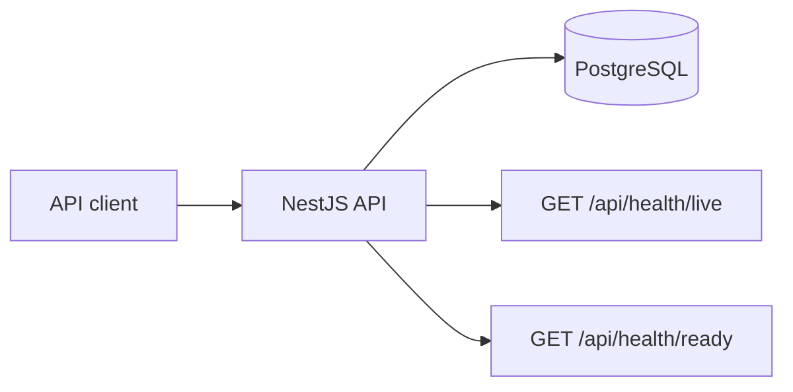
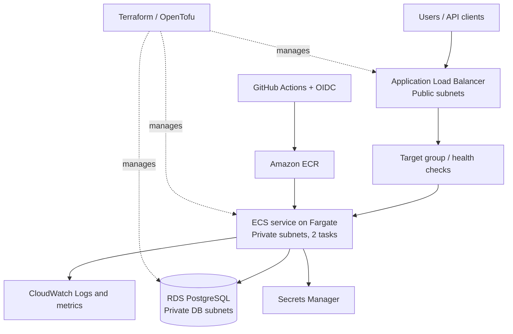

# TaskFlow API — AWS ECS/Fargate Learning Project

TaskFlow is a small task-management REST API built with **NestJS, TypeScript, PostgreSQL, TypeORM, and Docker**. It is the application we will use to learn Amazon ECS/Fargate end to end: images in ECR, VPC networking, IAM roles, task definitions, services, an Application Load Balancer, health checks, logging, scaling, deployments, CI/CD, and Infrastructure as Code.

> **Learning-project status:** This is a starter application for infrastructure practice, not a production-ready SaaS. Authentication/authorization, production secrets, backups, alerting, load testing, and a complete deployment pipeline will be added or validated in later learning phases before any real production use.

## Architecture today



The local Docker Compose setup starts PostgreSQL, runs database migrations as a separate one-off container, and then starts the API. Later, we will move the same image to Amazon ECR and run it as an ECS Fargate service behind an ALB.

## Stack

- Node.js 22 and NestJS 11
- TypeScript
- PostgreSQL 16
- TypeORM migrations (schema synchronization is disabled)
- Docker multi-stage image running as a non-root user
- Docker Compose for local integration
- Swagger/OpenAPI documentation
- Jest unit tests
- GitHub Actions CI workflow

## Prerequisites

- Node.js 22 or a compatible active LTS release
- pnpm 9.12.1 (the version already installed on your machine)
- Docker Desktop with WSL integration, or Docker Engine plus Docker Compose v2
- Git

## Run locally with Docker Compose

1. Copy the example environment file:

   ```bash
   cp .env.example .env
   ```

   On Windows PowerShell, use `Copy-Item .env.example .env`.

2. Open `.env` and set a local-only `DB_PASSWORD`. Do not use real AWS, staging, or production credentials here. The `.env` file is ignored by Git.

3. Install the JavaScript dependencies and generate the pnpm lockfile:

   ```bash
   pnpm install
   ```

   **Commit `pnpm-lock.yaml` to Git.** Reproducible dependency installation is important before we build and deploy images in later phases.

4. Start the full local stack:

   ```bash
   docker compose up --build
   ```

5. Open these URLs:

   - Swagger UI: <http://localhost:3000/docs>
   - Liveness: <http://localhost:3000/api/health/live>
   - Readiness (also checks PostgreSQL): <http://localhost:3000/api/health/ready>

The Compose `migrate` service waits for PostgreSQL to become healthy, applies pending migrations, and exits. The API starts after the migration job completes successfully. Compose startup dependencies and health checks are documented by Docker: <https://docs.docker.com/compose/how-tos/startup-order/>.

To stop the application without deleting its database volume:

```bash
docker compose down
```

To **delete the local database and all its data**, use this only when you intentionally want a clean reset:

```bash
docker compose down --volumes
```

## Run the API without building a container

Start PostgreSQL separately (or keep only the `db` service running), make sure `.env` points to a reachable database, then run:

```bash
pnpm install
pnpm migration:run
pnpm start:dev
```

If PostgreSQL is running in Docker and the API runs directly on your machine/WSL, `DB_HOST=localhost` is appropriate with this Compose file because the database port is bound to `127.0.0.1` on the host.

## API endpoints

All application endpoints use the `/api` prefix.

| Method | Endpoint | Purpose |
|---|---|---|
| `GET` | `/api/health/live` | Liveness probe; confirms that the HTTP process responds. |
| `GET` | `/api/health/ready` | Readiness probe; returns success only when PostgreSQL is reachable. |
| `POST` | `/api/tasks` | Create a task. |
| `GET` | `/api/tasks?page=1&limit=20` | List tasks with pagination. |
| `GET` | `/api/tasks?status=todo` | Filter tasks by status. |
| `GET` | `/api/tasks/:id` | Get a task by UUID. |
| `PATCH` | `/api/tasks/:id` | Update a task. |
| `DELETE` | `/api/tasks/:id` | Delete a task. |

Allowed task statuses are `todo`, `in_progress`, and `done`.

### Create a task

```bash
curl -X POST http://localhost:3000/api/tasks \
  -H 'Content-Type: application/json' \
  -d '{"title":"Deploy TaskFlow to ECS","description":"Build an image and push it to ECR"}'
```

### List tasks

```bash
curl 'http://localhost:3000/api/tasks?page=1&limit=20'
```

### Mark a task as done

Replace `TASK_UUID` with the `id` returned by the create request:

```bash
curl -X PATCH 'http://localhost:3000/api/tasks/TASK_UUID' \
  -H 'Content-Type: application/json' \
  -d '{"status":"done"}'
```

## Tests and build

```bash
pnpm lint
pnpm test
pnpm build
```

The GitHub Actions workflow runs lint, unit tests, and a build for pushes to `main` and pull requests.

## Database migrations

Schema synchronization is intentionally disabled. Database schema changes belong in versioned migrations rather than being silently generated by the application at startup.

```bash
pnpm migration:show
pnpm migration:run
pnpm migration:revert
```

For deployment, we will run migrations as a controlled one-off task/job before shifting application traffic, rather than letting every API replica race to change the schema.

## Initial GitHub setup

First, extract this ZIP and run `pnpm install` in the project directory. This project is configured to use pnpm 9.12.1, matching your existing installation and avoiding the need to enable Corepack on Windows. This creates `pnpm-lock.yaml`, which the Docker build and CI intentionally require. Then create a **private** empty repository on GitHub and run the following commands from the project directory:

```bash
git init
git add .
git commit -m "chore: bootstrap TaskFlow ECS learning project"
git branch -M main
git remote add origin git@github.com:YOUR_GITHUB_USERNAME/taskflow-ecs-project.git
git push -u origin main
```

Replace the remote URL with the URL of your private repository. Before pushing, run `git status` and verify that `.env` and any real credentials are not staged. Commit `.env.example`, not `.env`.

## Planned AWS target

The later AWS stages will build toward this architecture:



This is the learning target, not a claim that the AWS resources already exist. Network egress, VPC endpoints or NAT, TLS, IAM permissions, database protection, scaling, and rollback settings will be implemented and checked step by step.

## Repository guide

- `src/tasks/` — task API, validation DTOs, and database entity
- `src/health/` — liveness and readiness endpoints
- `src/database/` — TypeORM DataSource and migrations
- `Dockerfile` — multi-stage runtime image
- `compose.yaml` — local API, PostgreSQL, and migration job
- `.github/workflows/ci.yml` — build/test CI
- `docs/ecs-learning-roadmap-ar.md` — Arabic end-to-end study plan
- `docs/architecture.md` — architecture flow and component responsibilities

## Security and production checklist

Before using this service for real users, add and test authentication/authorization, request rate limiting, an explicit production CORS policy, production secret retrieval, TLS, database backup/restore procedures, metrics and actionable alarms, vulnerability scanning, dependency locking, load tests, and an incident/rollback runbook. Do not expose the database to the public internet. The AWS learning lab may also restrict which resources and IAM actions can be created.
