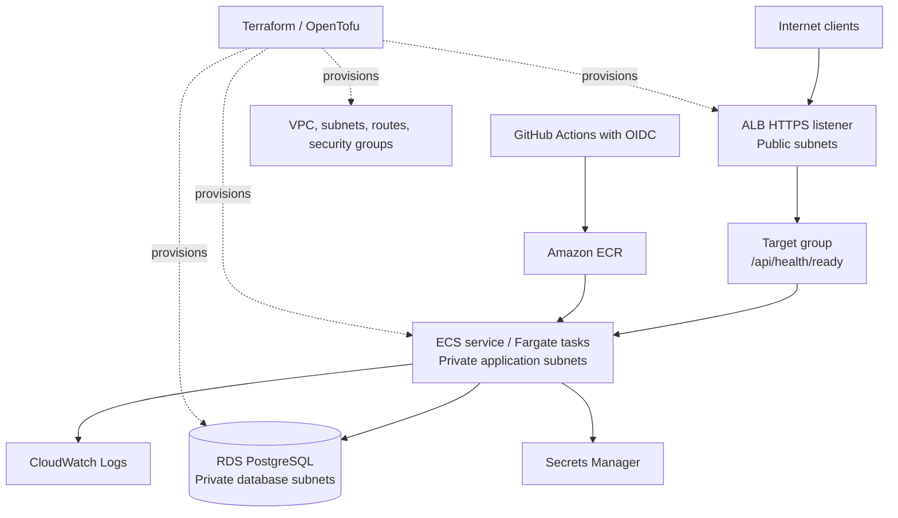

# TaskFlow architecture

## Current local architecture

```mermaid
flowchart TD
    Client[API client] --> API[NestJS API :3000]
    API --> DB[(PostgreSQL :5432)]
    Migration[One-off TypeORM migration job] --> DB
    API --> Liveness[/api/health/live]
    API --> Readiness[/api/health/ready]
```

The migration job runs after PostgreSQL becomes healthy. The API starts only after the migration job completes successfully. Application health is separated from dependency readiness so an orchestrator can distinguish a process that is alive from one that can currently serve database-backed requests.

## Target AWS architecture



## Security boundaries

- Only the ALB should accept public application traffic.
- The ECS task security group should accept the application port only from the ALB security group.
- The RDS security group should accept PostgreSQL traffic only from the ECS task security group.
- Secrets should be retrieved at runtime with narrowly scoped IAM permissions, not baked into the image.
- The ECS tasks need a designed egress path to image/log/secret endpoints. Choose NAT gateways or VPC endpoints based on actual requirements and cost.
- Production HTTPS, backup/restore, alerting, authentication, load testing, and rollback behavior must be configured and verified before real production use.
